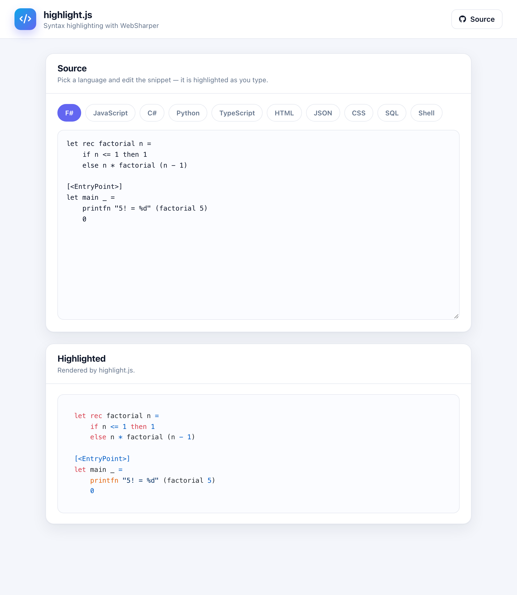

# WebSharper HighlightJS

A syntax-highlighting playground built with [WebSharper](https://websharper.com)
and the [WebSharper.HighlightJS](https://github.com/dotnet-websharper/highlightjs)
bindings: pick a language, edit the snippet, and [highlight.js](https://highlightjs.org/)
colorizes it as you type.

[](https://websharper-samples.github.io/HighlightJS)

**[Try it live](https://websharper-samples.github.io/HighlightJS)**

## What it shows

- A language switcher that swaps in a sample snippet for F#, JavaScript, C#,
  Python, TypeScript, HTML, JSON, CSS, SQL and Shell.
- Live re-highlighting on every keystroke, using `Hljs.HighlightElement`.
- The core build of highlight.js with just the languages we use registered via
  `Hljs.RegisterLanguage`.

## How it works

- `src/Client.fs` keeps the current language and source in `Var`s; the output is
  a `code` element whose class is `language-<id>` and which is re-highlighted on
  every update.
- `src/wwwroot/index.html` holds the page header, and highlight.js is bundled
  from npm by [esbuild](https://esbuild.github.io/).

## Running locally

```
dotnet run --project src
```

Then open <http://localhost:5369>.

## Building

```
dotnet build src/HighlightJS.fsproj -c Release
```

## Deployment

Every push to `master` builds in Release and publishes `src/wwwroot` to the
`gh-pages` branch via `.github/workflows/deploy.yml`.
